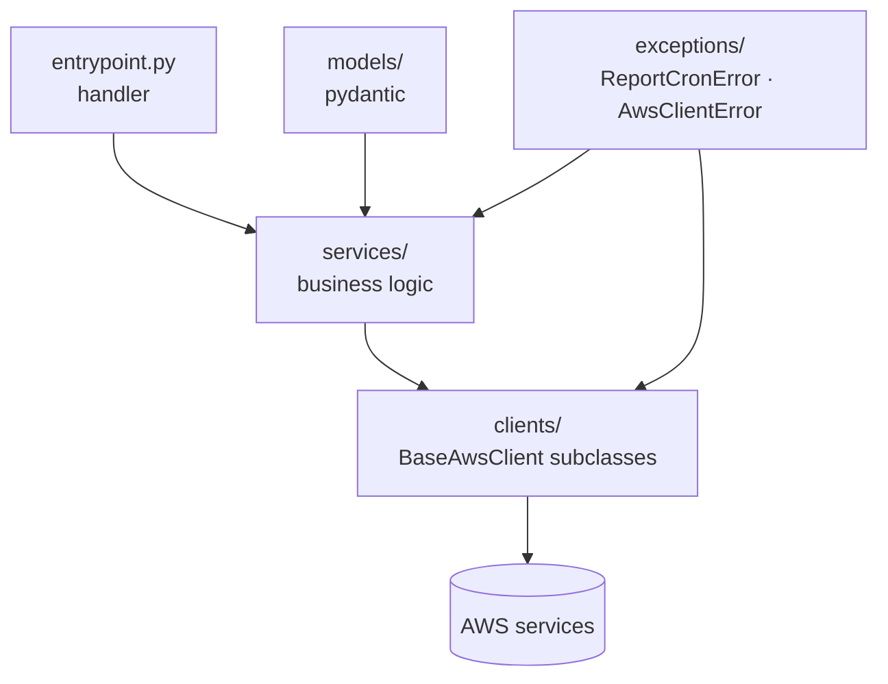

# report_cron

Add a scheduled serverless stack named report-cron comprising a Lambda function triggered every 15 minutes and a DynamoDB table for heartbeat persistence.

## Intent & Non-Goals

**Intent.** Implement the `lambda_scheduled` workload on the standard
layering: thin `entrypoint.py` wiring, pure business logic in `services/`,
AWS SDK access isolated in `clients/`, typed payloads in `models/`, and
domain errors in `exceptions/`.

**Non-goals.** No boto3 outside `clients/` (AST-enforced). No inline
comments (tokenizer-enforced; docstrings carry intent). No business logic
in `entrypoint.py`.

## Architecture

<!-- BEGIN_HARNESS_DOCS -->
## Environment Contract

| Variable | Source | Value/Path | Description |
| --- | --- | --- | --- |
| TABLE_NAME | plain | `module.heartbeat_store.table_name` | Target DynamoDB table name for heartbeat records. |

## Known Caveats & Next Steps

- No caveats recorded for this stack.
<!-- END_HARNESS_DOCS -->
