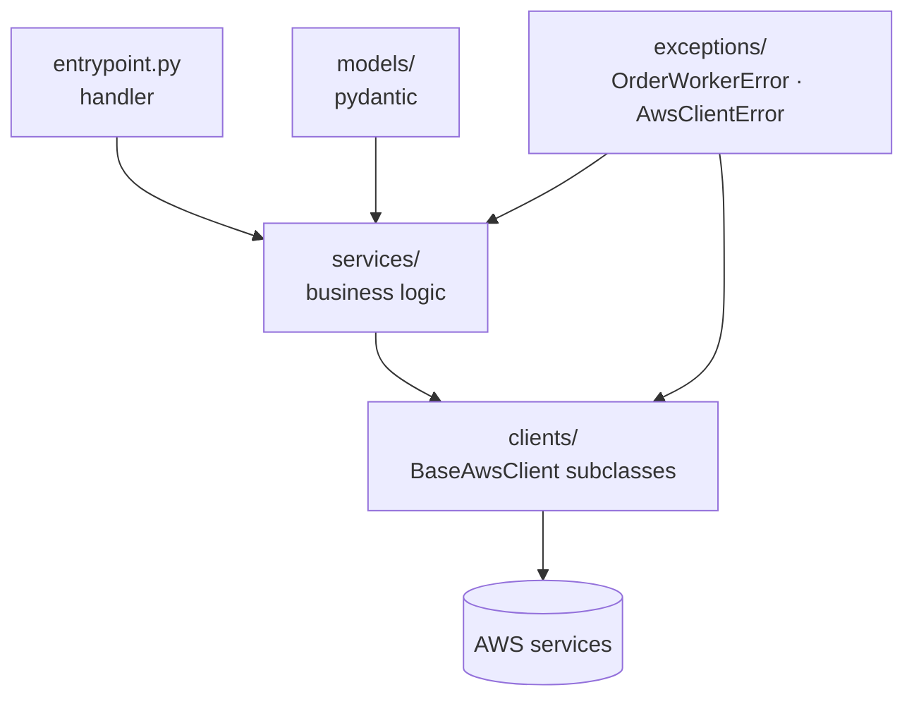

# order_worker

Add an SQS-driven Lambda worker that persists messages to a DynamoDB table with integrated dead-letter handling.

## Intent & Non-Goals

**Intent.** Implement the `lambda_sqs` workload on the standard
layering: thin `entrypoint.py` wiring, pure business logic in `services/`,
AWS SDK access isolated in `clients/`, typed payloads in `models/`, and
domain errors in `exceptions/`.

**Non-goals.** No boto3 outside `clients/` (AST-enforced). No inline
comments (tokenizer-enforced; docstrings carry intent). No business logic
in `entrypoint.py`.

## Architecture

<!-- BEGIN_HARNESS_DOCS -->
## Environment Contract

| Variable | Source | Value/Path | Description |
| --- | --- | --- | --- |
| ORDERS_TABLE_NAME | plain | `module.orders_table.table_name` | Name of the DynamoDB table for persisting orders. |

## Known Caveats & Next Steps

- No caveats recorded for this stack.
<!-- END_HARNESS_DOCS -->
