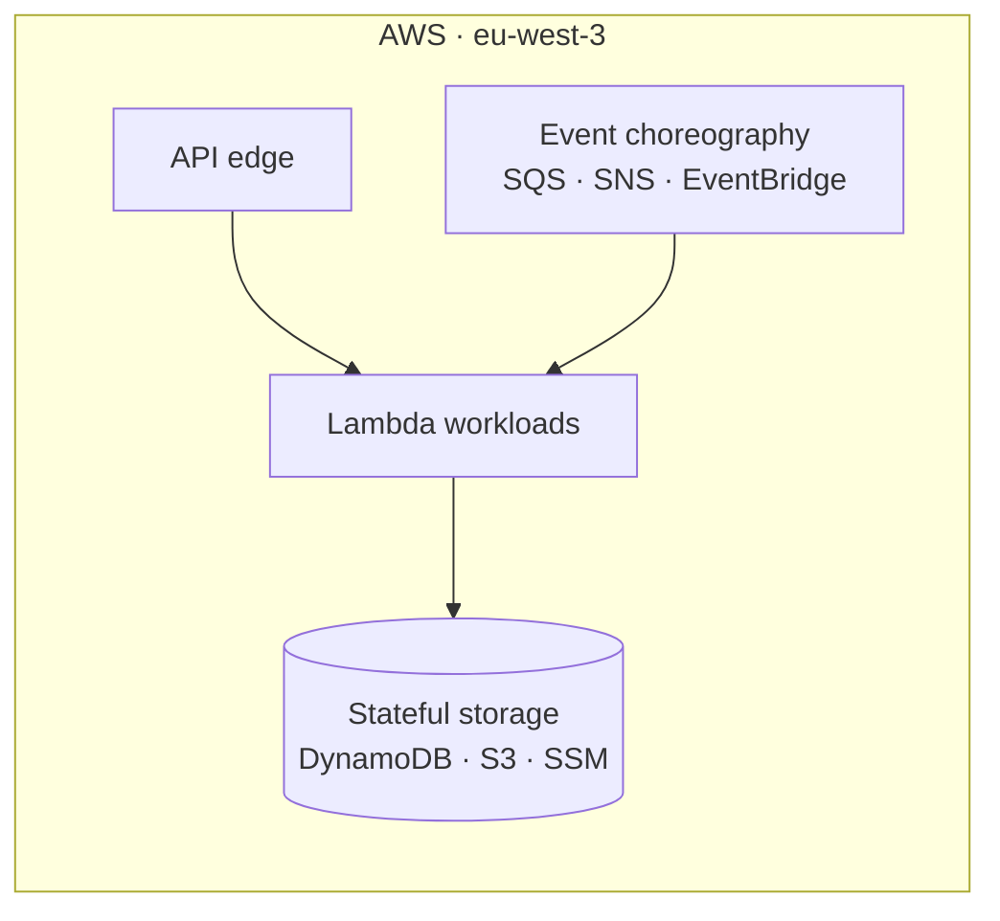

# arch-serverless-sqs

Campaign cell arch-serverless-sqs

This repository is composed and updated by an external repository harness.
Every themed stack, workload, and caveat is recorded in the canonical
contract at `.harness/state.yaml`; keep it schema-valid at all times.

## Intent & Non-Goals

**Intent.** Provide a strictly-governed serverless platform on AWS: one
folder per workload in `backend/`, one logical wiring layer in `infra/`,
and deterministic gates (pre-commit + CI) that reject drift automatically.

**Non-goals.** No secrets in code, tfvars, or state (SSM parameter paths and
Secrets Manager ARNs are referenced, never resolved at plan time). No
free-written documentation tables (terraform-docs and the state file render
them). No container workloads until the container pipeline is enabled.

## Architecture



## Repository Layout

| Path | Purpose |
| --- | --- |
| `infra/` | Terraform root, env definitions, locked logical modules |
| `backend/` | uv workspace; one strictly-layered package per workload |
| `scripts/` | Deterministic gate hooks (AST / tokenizer checks) |
| `.harness/` | Harness state ledger and run artifacts |

## Quickstart

```bash
uv run --directory backend pytest tests/unit
uvx pre-commit run --all-files
tflint --chdir=infra --init
terraform -chdir=infra init -backend-config=envs/dev.tfbackend
```

- The S3 state bucket `arch-serverless-sqs-tfstate-eu-west-3` must be
  created out-of-band before the first remote `terraform init`.
- The integration gate validates against a local AWS emulator: floci
  (pinned image, Podman locally, a service container in CI) by default,
  or the official AWS Emulator on Linux via `harness verify --backend
  aws-emulator`. Every gate run writes a receipt under
  `.harness/validation-runs/`.

<!-- BEGIN_HARNESS_DOCS -->
## Stacks

No themed stacks yet — add one with `harness stack add`.

## Known Caveats & Next Steps

- No stacks yet; caveats appear here after `harness stack add`.
<!-- END_HARNESS_DOCS -->
